<!-- Card 1: Master Hero with Portrait & Telemetry -->

<!-- Card 2, 3, 4: Three Linked Focus Tiles (width 32.5% each) -->

<!-- Card 5: Monthly Contributions & Performance Metrics -->

<!-- Card 6: Featured Repo 1 - DocNexus -->

<!-- Card 7: Featured Repo 2 - SANKET -->

<!-- Card 8: Featured Repo 3 - AuraDesign.AI -->

<!-- Card 9: Featured Repo 4 - E.D.I.T.H. -->

<!-- Card 10: Full 52-Week Contribution Matrix (Signal-Void Brand Colors) -->

<!-- Footer Connect -->

  
  
  

